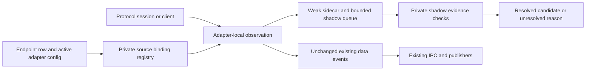

# Phase 2C-3: Trusted Protocol Evidence Integration Design

## Phase 2C-3A implementation status

The original design status below describes when this document was drafted.
Phase 2C-3A now provides isolated infrastructure only; no protocol evidence
integration or production caller was added in that slice. Phase 2C-3B and the
authorized Phase 2C-3C MQTT slice are implemented as isolated, opt-in shadow
integrations described below. Phase 2C-3C awaits independent review; later
phases remain unapproved.

**Files created:**

- [private-evidence-types.ts](../src/points/private-evidence-types.ts)
- [private-evidence-registry.ts](../src/points/private-evidence-registry.ts)
- [private-shadow-observer.ts](../src/points/private-shadow-observer.ts)
- [private-evidence-registry.unit.spec.ts](../test/unit/points/private-evidence-registry.unit.spec.ts)
- [private-shadow-observer.unit.spec.ts](../test/unit/points/private-shadow-observer.unit.spec.ts)

**Exports:** the types module exports `SourceBindingRef`, `ObservationRef`,
`ObservedAddress`, `SourceBindingProposal`, `ObservationClaims`,
`EvidenceReason`, `EvidenceResult`, `ShadowDecision`, and `ShadowMetadata`.
The registry exports `PrivateEvidenceRegistry` with `register`,
`replaceConfiguration`, `replaceTransport`, `invalidateBinding`,
`disposeAdapter`, `observe`, `inspect`, `correlation`, `transfer`,
`markDispatched`, `cleanup`, `drop`, and `dispose`. The observer exports
`ShadowObserverLimits`, `ShadowObserverCounters`, `ShadowCallback`, and
`PrivateShadowObserver` with `activate`, `submit`, `getCounters`, `deactivate`,
and asynchronous `dispose`.

All bindings are **proposals**, not independent source proof. References are
validated by registry-owned `WeakMap` identity, not by their shape or freezing.
Source claims and configuration objects must not conflict; observations
require the exact registered adapter and configuration objects. The registry
keeps weak adapter/configuration references, caps proposals at 1,024 by default,
and invalidates old observations on reported configuration or transport
replacement, binding invalidation, adapter disposal, or registry disposal.
Explicit replacement always advances the generation, including ABA. The
registry also caps outstanding observations at 1,024 by default; the
configurable maximum must be an integer from 1 through 8,192. Capacity is
released by `drop` and by configuration/transport replacement, binding
invalidation, adapter disposal, and registry disposal. When at capacity, stale
entries whose weak adapter/configuration references are unavailable are
reclaimed before rejecting a new observation. No active observation is
evicted to admit another, and no point or session object is retained by the
active index. An observation that is still valid but never dropped or
invalidated occupies capacity; callers must report lifecycle changes and
explicitly clean up. No timer or garbage-collection-only cleanup is required.
The
correlation sidecar never mutates the point; known clones require explicit
transfer. `cleanup` removes one object's association; `drop` invalidates the
observation and all its associations. `markDispatched` is an explicit caller
claim, not evidence that dispatch occurred. Forged, missing, conflicting and
stale references return unresolved.

**Trust limitation:** reported generation changes cover only calls into this
isolated module. The current manager does not report all changes, and this
registry cannot detect unreported mutation, external writers or session
replacement. Therefore even `candidate-observed` cannot establish live
freshness, source ownership or catalog admission. Canonicalizer input/result
claims, including `verified: true`, are accepted as caller claims and
discarded. The decision contract contains only `unresolved` and provisional
`candidate-observed`; it does not include canonical or source-bound trust
states. No real protocol evidence is trusted. Production
catalog reads/writes, UUID creation and production verifier use remain
prohibited.

The observer has no singleton, runtime registration or activation by default.
Defaults are 256 queued observations, 512 bytes of serialized metadata plus
retained address/source claim, batches of 16, and 5 seconds queued lifetime.
Hard maxima are respectively 1,024, 8,192 bytes, 64, and 60 seconds; one
callback may additionally be in flight. Oversized evidence and overflow are
rejected without truncation and invalidate the affected observation. Queued
items expire even while a callback is pending; counters saturate at
2,147,483,647. Callback metadata is a frozen primitive-only copy without
address, source claim, payload, value, credential or session. Synchronous and
asynchronous callback failures are counted and isolated. `deactivate` and
`dispose` cancel the observer's timers/immediate and drop queued evidence.
Deactivation is nonblocking, but reactivation fails while an earlier callback
is still in flight; it is allowed once that callback resolves or rejects.
Consequently an old callback cannot process a later activation's queue.

**Callback isolation limit:** JavaScript cannot forcibly stop arbitrary
already-running callback code or its independently created work. `dispose()`
waits asynchronously for an in-flight callback to settle and may never finish
if it does not; the callback itself could still block the event loop or retain
its own resources. No further queued callback starts after disposal begins.
These limits prevent production activation until a separately reviewed
isolation and lifecycle contract exists; no hard telemetry-latency guarantee
is claimed.

**Verification from `C:\Users\Dan\iot-agent`:**

```powershell
npx tsc --noEmit
npx tsc --noEmit -p tsconfig.build.json
npm run lint
npx eslint --parser-options project:./test/tsconfig.json test\unit\points\private-evidence-registry.unit.spec.ts test\unit\points\private-shadow-observer.unit.spec.ts
$env:DATABASE_PATH='C:\Users\Dan\.copilot\session-state\9f165ade-3b77-4328-a779-0d3828140c37\files\phase2c3a-correction-focused.sqlite'
npx jest --config jest.config.unit.js --runInBand --detectOpenHandles --forceExit=false --runTestsByPath test\unit\points\private-evidence-registry.unit.spec.ts test\unit\points\private-shadow-observer.unit.spec.ts --silent
$env:DATABASE_PATH='C:\Users\Dan\.copilot\session-state\9f165ade-3b77-4328-a779-0d3828140c37\files\phase2c3a-correction-regression.sqlite'
npx jest --config jest.config.unit.js --runInBand 'canonical-address.unit.spec.ts|test\\unit\\devices\\opcua\\.*unit.spec.ts|test\\unit\\devices\\mqtt\\.*unit.spec.ts|test\\unit\\devices\\modbus\\.*unit.spec.ts|test\\unit\\devices\\bacnet\\.*unit.spec.ts|socket-server.unit.spec.ts|resolve-enriched-device-name.unit.spec.ts|group-field-names-by-owning-device.unit.spec.ts' --silent --verbose=false
$env:DATABASE_PATH='C:\Users\Dan\.copilot\session-state\9f165ade-3b77-4328-a779-0d3828140c37\files\phase2c3a-correction-integration.sqlite'
npx jest --config jest.config.integration.js --runInBand 'point-identity-catalog.integration.spec.ts|point-identity-migration.integration.spec.ts|endpoint-device-enabled.integration.spec.ts' --silent --verbose=false
$env:DATABASE_PATH='C:\Users\Dan\.copilot\session-state\9f165ade-3b77-4328-a779-0d3828140c37\files\phase2c3a-correction-node.sqlite'
node --import tsx --test test\unit\devices\opcua\opcua-device-identification.test.ts test\unit\devices\opcua\opcua-device-snapshot.test.ts test\unit\devices\opcua\opcua-discovery-safety.test.ts
```

Both TypeScript checks and both lint checks passed. The focused run passed
31/31 tests in two suites without forced exit or detected open handles.
Integration passed 74/74 tests in three suites, and Node discovery passed
11/11. The broader selection passed 276 and failed seven tests across 16
suites; the other 15 suites passed, including 80 canonicalizer tests and the
BACnet, Modbus, OPC UA, discovery and socket regressions. SQLite emitted its
experimental warning; the unit Jest configuration reported its force-exit
warning for the broader run. No unrelated fix was made.

The seven MQTT failures were reproduced in a separate copy of the pre-correction
working tree with the original Phase 2C-3A patch reversed, using the same
dependencies through a junction and an isolated database. The restored design
was compared against its captured pre-2C-3A version. The baseline command was:

```powershell
Set-Location 'C:\Users\Dan\.copilot\session-state\9f165ade-3b77-4328-a779-0d3828140c37\files\phase2c3a-mqtt-comparison'
$env:DATABASE_PATH='C:\Users\Dan\.copilot\session-state\9f165ade-3b77-4328-a779-0d3828140c37\files\phase2c3a-correction-mqtt-baseline.sqlite'
npx jest --config jest.config.unit.js --runInBand --runTestsByPath test\unit\devices\mqtt\mqtt-adapter.unit.spec.ts --silent
```

Baseline: 53 passed, seven failed. All are `MqttAdapter > handleMessage -
Backpressure` tests; the same failures occurred in the current selection:

- `should convert configured metric values into the canonical configured unit`:
  expected 25 C, received 77 F.
- `should round converted values to two decimals by default`: expected
  22.22 C, received 72 F.
- `should convert configured temperature values through Kelvin as the base unit`:
  expected K, received F.
- `should log unknown units encountered during canonicalization`: expected
  `temperature` value 22, received `test/topic` with BAD `PARSE_ERROR`.
- `should apply defaultUnits canonical conversion for autoMetrics fields`:
  expected C, received F.
- `should honor configured precision for autoMetrics defaultPrecisions`:
  expected 22.2 C, received 72 F.
- `should convert pressure units through Pa as the base unit for autoMetrics defaultUnits`:
  expected kPa, received psi.

## Phase 2C-3B OPC UA implementation status

The manager accepts an optional private registry/observer injection; no
application startup enables it. On grouped database startup and reload, it
pairs each actual constructed OPC UA configuration object with its source
record from the manager's existing `getAll` snapshot. Missing IDs/UUIDs,
duplicate IDs or UUIDs, duplicate member names and non-membership in that
snapshot do not produce a binding. Explicit application configuration and the
standalone enabled-only lookup have no complete manager snapshot and remain
unresolved. This is a provisional binding proposal, not proof of persistent
source ownership or freshness; the private injection is not an authorization
boundary against arbitrary in-process callers.

Subscription capture uses the monitored item and its original request slot;
poll capture uses the actual request array and corresponding response positions.
The OPC UA positional response contract is required: an incorrectly reordered
same-length server response is not independently detectable. Unexpected result
counts produce no evidence without changing legacy behavior. Pooled members
with duplicate NodeIds, including equivalent numeric representations, are
unresolved. If any configured NodeId cannot be normalized for comparison, the
entire pooled group is unresolved. Neither display name nor value is used to
associate an address.

The registry associates the exact point object at construction. The adapter
marks it dispatched at its `data` emission and the manager explicitly transfers
correlation when it makes its existing enrichment clone. The existing observer
receives only its approved primitive metadata, not NodeIds or payloads. An
accepted observer owns and eventually drops the observation; a disabled, full,
or failing observer drops it immediately. If a data listener throws, the
original exception propagates, no observation is submitted, and the affected
observations are dropped. Undispatched poll observations are released on the
next event-loop turn. Transport-loss events invalidate the
previous generation, adapter shutdown/reload invalidates bindings, and late
callbacks from an old wrapper are unresolved. An observed library session
repair retires affected bindings until a new adapter is constructed, including
repairs during initialization. No extra network or database reads are made.

Unreported in-place configuration mutation, external database writers and
session changes not exposed by existing events cannot be proven fresh. No
NamespaceArray or verified server continuity is established, and namespace
indexes are not durable across sessions. No real protocol evidence is trusted
for catalog admission. A stalled observer callback can still retain its one
in-flight observation until it settles or its binding is invalidated.

**Verification from `C:\Users\Dan\iot-agent`:**

```powershell
npx tsc --noEmit
npx tsc --noEmit -p tsconfig.build.json
npm run lint
npx eslint --parser-options project:./test/tsconfig.json test\unit\devices\opcua\opcua-shadow-evidence.unit.spec.ts test\unit\devices\opcua\opcua-shadow-manager.test.ts
$env:DATABASE_PATH='C:\Users\Dan\.copilot\session-state\9f165ade-3b77-4328-a779-0d3828140c37\files\phase2c3b-focused.sqlite'
npx jest --config jest.config.unit.js --runInBand --detectOpenHandles --forceExit=false --runTestsByPath test\unit\devices\opcua\opcua-shadow-evidence.unit.spec.ts test\unit\points\private-evidence-registry.unit.spec.ts test\unit\points\private-shadow-observer.unit.spec.ts --silent
$env:DATABASE_PATH='C:\Users\Dan\.copilot\session-state\9f165ade-3b77-4328-a779-0d3828140c37\files\phase2c3b-regression.sqlite'
npx jest --config jest.config.unit.js --runInBand 'canonical-address.unit.spec.ts|test\\unit\\devices\\opcua\\.*unit.spec.ts|socket-server.unit.spec.ts|message-batcher.unit.spec.ts|socket-publish-client.unit.spec.ts|group-field-names-by-owning-device.unit.spec.ts|resolve-enriched-device-name.unit.spec.ts' --silent --verbose=false
$env:DATABASE_PATH='C:\Users\Dan\.copilot\session-state\9f165ade-3b77-4328-a779-0d3828140c37\files\phase2c3b-integration.sqlite'
npx jest --config jest.config.integration.js --runInBand 'point-identity-catalog.integration.spec.ts|point-identity-migration.integration.spec.ts|endpoint-device-enabled.integration.spec.ts' --silent --verbose=false
$env:DATABASE_PATH='C:\Users\Dan\.copilot\session-state\9f165ade-3b77-4328-a779-0d3828140c37\files\phase2c3b-node.sqlite'
node --import tsx --test test\unit\devices\opcua\opcua-device-identification.test.ts test\unit\devices\opcua\opcua-device-snapshot.test.ts test\unit\devices\opcua\opcua-discovery-safety.test.ts test\unit\devices\opcua\opcua-device-display.test.ts
$env:DATABASE_PATH='C:\Users\Dan\.copilot\session-state\9f165ade-3b77-4328-a779-0d3828140c37\files\phase2c3b-manager.sqlite'
node --import tsx --test test\unit\devices\opcua\opcua-shadow-manager.test.ts
```

The TypeScript and lint checks passed. The focused run passed 42 tests in
three suites; the broader regression selection passed 166 tests in 13 suites,
including the focused OPC UA tests. Catalog, migration and discovery
integration passed 74 tests in three suites. OPC UA discovery/display Node
tests passed 13 tests, and the manager startup/reload test passed one. SQLite
emitted its experimental warning, and the broader unit Jest run reported its
configured force-exit warning. The previously documented seven MQTT baseline
failures were not rerun or changed.

### Phase 2C-3B final corrections

The production polling path is `BaseProtocolAdapter.startPolling()` in
[`base.ts`](../src/plugins/base.ts): it awaits `readDeviceData()`, updates the
status and, for nonempty results, synchronously emits `data` and then
`data-received` in the same promise continuation, without awaiting or
scheduling between the returned points and emission. The protected OPC UA read
constructs its observations only after the asynchronous client read completes.
Consequently the existing
`setImmediate` cleanup runs after normal polling dispatch; it also releases
constructed observations if the result is never dispatched. A caller that
directly invokes the protected read and delays emission beyond that cleanup
does not retain shadow evidence. Reconnect and disposal invalidate outstanding
observations, and session repair continues to retire the binding.

Focused tests exercise the production poller with a delayed client read,
event order and payload, undispatched results with a one-observation capacity,
reconnect and disposal, successful submission, and a throwing listener that
propagates the identical error without submitting evidence. Legacy listeners
and data payloads remain unchanged.

Verification from `C:\Users\Dan\iot-agent`:

```powershell
npx tsc --noEmit
npx tsc --noEmit -p tsconfig.build.json
npm run lint
npx eslint --parser-options project:./test/tsconfig.json test\unit\devices\opcua\opcua-shadow-evidence.unit.spec.ts
$env:DATABASE_PATH='C:\Users\Dan\.copilot\session-state\9f165ade-3b77-4328-a779-0d3828140c37\files\phase2c3b-corrections-focused.sqlite'
npx jest --config jest.config.unit.js --runInBand --detectOpenHandles --forceExit=false --runTestsByPath test\unit\devices\opcua\opcua-shadow-evidence.unit.spec.ts test\unit\points\private-evidence-registry.unit.spec.ts test\unit\points\private-shadow-observer.unit.spec.ts --silent
$env:DATABASE_PATH='C:\Users\Dan\.copilot\session-state\9f165ade-3b77-4328-a779-0d3828140c37\files\phase2c3b-corrections-regression.sqlite'
npx jest --config jest.config.unit.js --runInBand 'test\\unit\\devices\\opcua\\.*unit.spec.ts|base-adapter.unit.spec.ts|socket-server.unit.spec.ts|message-batcher.unit.spec.ts|socket-publish-client.unit.spec.ts|group-field-names-by-owning-device.unit.spec.ts|resolve-enriched-device-name.unit.spec.ts' --silent --verbose=false
$env:DATABASE_PATH='C:\Users\Dan\.copilot\session-state\9f165ade-3b77-4328-a779-0d3828140c37\files\phase2c3b-corrections-node.sqlite'
node --import tsx --test test\unit\devices\opcua\opcua-device-identification.test.ts test\unit\devices\opcua\opcua-device-snapshot.test.ts test\unit\devices\opcua\opcua-discovery-safety.test.ts test\unit\devices\opcua\opcua-device-display.test.ts test\unit\devices\opcua\opcua-shadow-manager.test.ts
```

Both TypeScript checks and both lint commands passed. The focused run passed
45 tests in three suites, the regression selection passed 94 tests in 13
suites, and the Node tests passed 14 tests. The broader Jest configuration
reported its force-exit warning; SQLite reported its experimental warning.
An initial focused run left a fixture's manually started polling timer active
and failed after its assertions; the fixture was corrected and the run passed
without forced exit. The previously documented MQTT failures were not rerun.

## Phase 2C-3C MQTT implementation status

The manager's optional MQTT-specific injection is off by default. Grouped
database startup pairs exact configuration objects with unique endpoint records
from its existing full endpoint snapshot. Explicit configuration and the
enabled-only standalone/hot-reload path do not establish this provenance.
Matching filters are checked across the snapshot's enabled MQTT endpoints as
well as the adapter's actual subscription membership; overlaps, duplicate
memberships and conflicting endpoint records produce no evidence. The binding
is provisional and does not prove physical device or broker ownership.

At `handleMessage`, configured metric traversal records the actual container
type and existing property at each access; it does not infer a key or index
solely from legacy selector text. Automatic and fallback primitive fields use
their actual object key, while primitive whole-message selection uses `whole`.
Missing fields are not recorded; present `null` values are captured only if
the existing conversion emits a point. Binary marker and serialized-object
fallbacks remain unresolved. Traversals through inherited properties,
non-index array properties or primitive intermediates are unresolved. The
registry copies and freezes selectors, limits paths to 32 tokens and bounds
the combined topic/selector representation to 8192 UTF-8 bytes.

The existing queue transfers correlation to its display-name clone, and the
manager transfers it to its enrichment clone. At the existing listener dispatch
boundary, the adapter marks points dispatched and submits only after all
listeners complete without throwing; rejected submissions and queue overflow
drop evidence. Capture requires a currently connected transport after its
connect callback; offline, close and reconnect callbacks suspend capture.
Disconnect, reconnect, configuration update and adapter stop invalidate
observations. A manager-triggered MQTT refresh conservatively retires bindings
across all MQTT groups, not just the group being updated: same-topic legacy
configurations can remain in the subscription map, and the enabled-only lookup
lacks a complete source snapshot, so
evidence stays unresolved until the adapter is reconstructed with a fresh
grouped snapshot. A listener that never settles can retain bounded evidence
until transport or binding invalidation. External configuration changes not
observed by the adapter remain unproven. No catalog admission is authorized.

Verification from `C:\Users\Dan\iot-agent`:

```powershell
npx tsc --noEmit
npx tsc --noEmit -p tsconfig.build.json
npm run lint
npx eslint --parser-options project:./test/tsconfig.json test\unit\devices\mqtt\mqtt-shadow-evidence.unit.spec.ts test\unit\points\private-evidence-registry.unit.spec.ts
$env:DATABASE_PATH='C:\Users\Dan\.copilot\session-state\9f165ade-3b77-4328-a779-0d3828140c37\files\phase2c3c-focused.sqlite'
npx jest --config jest.config.unit.js --runInBand --detectOpenHandles --forceExit=false --runTestsByPath test\unit\devices\mqtt\mqtt-shadow-evidence.unit.spec.ts test\unit\points\private-evidence-registry.unit.spec.ts test\unit\points\private-shadow-observer.unit.spec.ts --silent
$env:DATABASE_PATH='C:\Users\Dan\.copilot\session-state\9f165ade-3b77-4328-a779-0d3828140c37\files\phase2c3c-mqtt.sqlite'
npx jest --config jest.config.unit.js --runInBand --runTestsByPath test\unit\devices\mqtt\mqtt-adapter.unit.spec.ts test\unit\devices\mqtt\mqtt-discovery.unit.spec.ts test\unit\devices\mqtt\mqtt-conversion-migration.unit.spec.ts --silent --verbose=false
$env:DATABASE_PATH='C:\Users\Dan\.copilot\session-state\9f165ade-3b77-4328-a779-0d3828140c37\files\phase2c3c-regression.sqlite'
npx jest --config jest.config.unit.js --runInBand 'canonical-address.unit.spec.ts|test\\unit\\devices\\opcua\\.*unit.spec.ts|base-adapter.unit.spec.ts|socket-server.unit.spec.ts|message-batcher.unit.spec.ts|socket-publish-client.unit.spec.ts|group-field-names-by-owning-device.unit.spec.ts|resolve-enriched-device-name.unit.spec.ts' --silent --verbose=false
$env:DATABASE_PATH='C:\Users\Dan\.copilot\session-state\9f165ade-3b77-4328-a779-0d3828140c37\files\phase2c3c-node.sqlite'
node --import tsx --test test\unit\devices\opcua\opcua-device-identification.test.ts test\unit\devices\opcua\opcua-device-snapshot.test.ts test\unit\devices\opcua\opcua-discovery-safety.test.ts test\unit\devices\opcua\opcua-device-display.test.ts test\unit\devices\opcua\opcua-shadow-manager.test.ts
```

Both TypeScript checks and both lint commands passed. MQTT/private evidence
tests passed 43/43 in three suites, canonicalizer/OPC UA/telemetry regressions
passed 174/174 in 14 suites, and Node tests passed 14/14. Existing MQTT tests
passed 100 and failed seven across three suites; these are the same seven
independently reproduced baseline failures listed in the Phase 2C-3A status
above. The broader Jest configuration reported its force-exit warning; SQLite
reported its experimental warning. A focused test initially expected the wrong
unresolved reason after update; the expectation was corrected to reflect that
no new observation exists.

### MQTT filter provenance verification

Grouped startup constructs each effective `subscriptionTopic` as
`baseTopic/#`, falling back to `topic/#` or `#` for an empty base. The manager's
enabled-endpoint snapshot uses the same expression. The adapter registers only
enabled devices and `resolveSubscriptionTopic()` uses that constructed value;
the snapshot can conservatively include groups that did not start or subscribe
successfully. A database connection's `subscriptionTopic` is not used by this
grouped path. Explicit in-memory devices can supply a custom subscription
filter, but the explicit manager path has no source bindings and therefore
does not produce shadow evidence. The standalone database path uses the encoded
device name when its base is empty; it likewise has no source bindings.

The snapshots were equivalent at grouped startup but could become stale across
groups on a manager-triggered MQTT reload. Refreshing the default group can
change its effective filters without rebuilding other groups. The manager now
retires private bindings for every running MQTT group before that refresh;
existing pending observations are invalidated and new evidence remains
unresolved until reconstruction. This does not change subscription registration,
message routing, or the legacy payload.

Verification from `C:\Users\Dan\iot-agent`:

```powershell
npx tsc --noEmit
npx tsc --noEmit -p tsconfig.build.json
npm run lint
npx eslint --parser-options project:./test/tsconfig.json test\unit\devices\mqtt\mqtt-shadow-evidence.unit.spec.ts
$env:DATABASE_PATH='C:\Users\Dan\.copilot\session-state\9f165ade-3b77-4328-a779-0d3828140c37\files\phase2c3c-filter-focused.sqlite'
npx jest --config jest.config.unit.js --runInBand --detectOpenHandles --forceExit=false --runTestsByPath test\unit\devices\mqtt\mqtt-shadow-evidence.unit.spec.ts test\unit\points\private-evidence-registry.unit.spec.ts test\unit\points\private-shadow-observer.unit.spec.ts --silent
$env:DATABASE_PATH='C:\Users\Dan\.copilot\session-state\9f165ade-3b77-4328-a779-0d3828140c37\files\phase2c3c-filter-regression.sqlite'
npx jest --config jest.config.unit.js --runInBand 'test\\unit\\devices\\opcua\\opcua-shadow-evidence.unit.spec.ts|socket-server.unit.spec.ts|message-batcher.unit.spec.ts|socket-publish-client.unit.spec.ts|resolve-enriched-device-name.unit.spec.ts' --silent --verbose=false
$env:DATABASE_PATH='C:\Users\Dan\.copilot\session-state\9f165ade-3b77-4328-a779-0d3828140c37\files\phase2c3c-filter-mqtt.sqlite'
npx jest --config jest.config.unit.js --runInBand --runTestsByPath test\unit\devices\mqtt\mqtt-adapter.unit.spec.ts test\unit\devices\mqtt\mqtt-discovery.unit.spec.ts test\unit\devices\mqtt\mqtt-conversion-migration.unit.spec.ts --silent --verbose=false
```

Both TypeScript checks and both lint commands passed. Focused tests passed
45/45 in three suites, and manager/telemetry regressions passed 47/47 in five
suites. Existing MQTT tests passed 100 and failed the same seven baseline
unit-conversion tests listed above. The broader Jest configuration reported its
force-exit warning; SQLite reported its experimental warning.

**Original design status at drafting:** design only; independent review and
explicit approval required. No Phase 2C-3 code had been implemented at that
time. Current implementation status is described above. This document distinguishes
repository observations from proposals and unresolved prerequisites. It does
not approve catalog use, point creation, reconciliation, or Phase 2C-4.

## 1. Executive summary and scope

A durable point belongs to a source endpoint and a protocol; equipment
association is optional. Neither a source UUID nor an adapter "device" is
necessarily a physical DeviceUUID. Names, device UUIDs, endpoint names, aliases,
timestamps, and generated provisional name IDs do not establish point identity.
Ambiguity must remain unresolved.

The proposed integration is **private, opt-in shadow observation**, off by
default. It must not create Point UUIDs, read or write the point-identity
catalog, populate aliases, backfill, mutate discovery evidence, or attach
equipment. It must not change existing adapters' observable data, IPC, APIs,
MQTT topics, telemetry, TimescaleDB, cloud ingestion, or Web Admin. It has no
production verifier and performs no authorization or durable admission.
Failure of shadow collection cannot interrupt or change legacy processing.
There is no physical-device inference or exposed evidence envelope.

The architectural baseline is
[Phase 2 design](phase2-point-identity-design.md) and
[Phase 2C integration design](phase2c-point-identity-integration-design.md).
The isolated implementation is
[point-identity-catalog.ts](../src/points/point-identity-catalog.ts);
the standalone resolver is
[canonical-address.ts](../src/points/canonical-address.ts).
The legacy provisional name-derived ID in
[identity.ts](../src/points/identity.ts#L22) is a separate mechanism, not the
durable Point UUID.

## 2. Current lifecycle and trust boundaries

**Observed.** [AdapterManager](../src/plugins/index.ts#L473) groups database
endpoints by protocol/group and uses explicit in-memory application config when
no database group exists. [buildUuidMap](../src/plugins/index.ts#L241) is keyed
by device name and falls back through metadata, including `device_uuid`.
[resolveEnrichedDeviceName](../src/plugins/index.ts#L112) can use endpoint UUID
as a device fallback. Neither is trusted source-to-sample proof. Grouped MQTT
and BACnet construction does not pass each source UUID into the adapter device
object ([MQTT](../src/plugins/index.ts#L919),
[BACnet](../src/plugins/index.ts#L1274)); Modbus group construction does pass
UUID and normalized register config ([index.ts](../src/plugins/index.ts#L625)).
An explicit configuration is not necessarily backed by a uniquely identified
endpoint row. No such input is automatically authoritative.
Endpoint persistence and UUID lookup are implemented in
[endpoint.model.ts](../src/db/models/endpoint.model.ts); existing
[device-resolution-store.ts](../src/discovery/device-resolution-store.ts)
records source-scoped equipment evidence, not proof of point-address
ownership. Existing [DeviceDataPoint](../src/plugins/types.ts#L18) does not
carry canonical point-address evidence.

The existing path is adapter `data` -> manager enrichment ->
[SocketServer](../src/core/socket-server.ts#L247) JSON/CSV formatting ->
[MessageBatcher](../src/publish/core/batch.ts#L179) ->
[PublishManager](../src/publish/core/manager.ts#L702), anomaly processing and
destination publishing. The fields projected by
[formatAsJson](../src/core/socket-server.ts#L903) and
[formatAsCsv](../src/core/socket-server.ts#L946) are existing contracts.
Nothing about that path authenticates a point address.

**Proposed private boundary:**



The private side channel is separate from the public legacy event; it never
reaches `DeviceDataPoint`, IPC or a publisher. A future verifier would be a
distinct, reviewed authority. The isolated catalog currently accepts an
injected verifier; test fixtures do not authorize production operations.
Canonicalization is deterministic validation, not source authentication,
ownership proof, new-point admission, or a proof of live freshness. In
particular its `verified: true`, `complete: true`, and
`uniqueDeviceInstance: true` inputs are caller assertions, not evidence.

## 3. Evidence envelope and trust tiers

**Proposed conceptual TypeScript**, not an existing API. It is module-private,
not serializable to existing contracts. Exact discriminants can be finalized
in the separately approved implementation:

```ts
import type {
  AddressProtocol, CanonicalAddressInput, CanonicalAddressResult,
} from './canonical-address.js';

type Generation = Readonly<{
  ownerEpoch: number;          // process-lifetime registry, not a DB revision
  configEpoch: number;
  transportEpoch: number;
}>;
type Correlation = Readonly<{
  adapterInstance: object;     // private identity; never serialized
  localSequence: number;       // ephemeral, not a UUID or point identity
  phase: 'constructed' | 'adapter-dispatched';
}>;
type Observed =
  | Readonly<{ protocol: 'opcua'; nodeId: string; memberSlot: number;
      requestSlot: number; sessionHandle: object }>
  | Readonly<{ protocol: 'mqtt'; topic: string; matchedFilter: string;
      extraction: 'configured' | 'automatic' | 'fallback';
      selection: 'whole' | 'field'; payloadHandle: object }>
  | Readonly<{ protocol: 'modbus'; registerSlot: number; unitId: number;
      functionCode: number; address: number; count: number;
      readMode: 'direct' | 'batch' }>
  | Readonly<{ protocol: 'bacnet'; objectSlot: number; objectType: number;
      objectInstance: number; effectivePropertyId: number; clientHandle: object }>;
type Assertion = Readonly<{
  claimedEndpointUuid?: string;
  configuredSource?: string;   // description, not a proof or a name-based join
}>;
type EvidenceRef = Readonly<{
  // Opaque handle minted and checked by the private registry, not supplied by
  // a caller and not trusted merely because it has this TypeScript shape.
  handle: object;
}>;
type Candidate = Readonly<{
  protocol: AddressProtocol;
  observed: Observed;
  assertions: Assertion;
  sourceBinding?: EvidenceRef;
  freshness?: Generation;
  correlation: Correlation;
  canonicalInput?: CanonicalAddressInput;
  canonicalResult?: CanonicalAddressResult;
}>;
type ShadowDecision =
  | Readonly<{ status: 'candidate-resolved'; endpointUuid: string;
      candidate: Candidate; binding: EvidenceRef; observation: EvidenceRef }>
  | Readonly<{ status: 'unresolved'; reason: string; candidate: Candidate }>;
```

`observed` records facts directly captured at a read/extraction; `assertions`
are configuration or caller claims; evidence handles refer to independently
checked registry records with provenance and lifecycle, not exported booleans.
A structurally resolved `canonicalResult` may still yield `unresolved` at the
shadow boundary. `candidate-resolved` means only that the stated shadow
checks passed for this observation; it is **not** a durable identity,
admission, equivalence, a catalog capability, or permission to write.

The implementation must enforce the matching protocol across each union,
uniquely bind the actual sample and source, validate the address against the
observed input, and fail closed on missing handles or stale epochs. TypeScript
brands, frozen objects, a user-supplied handle, endpoint-row equality, hashes,
and wall-clock timestamps alone are not authorization. Deep-copy/freeze only
minimal address facts; keep opaque object handles internal. Do not retain
payloads, values, credentials, certificates, or session objects in logs.
Shadow state is ephemeral and bounded; no evidence or sample values are
persisted.

## 4. Source binding, configuration and freshness

**Proposed source binding.** At adapter construction, the manager must retain a
private positional binding from the *actual source record and configuration
object* to the precise adapter member and effective point configuration. The
record must identify one nonempty endpoint UUID and protocol, and the same
source must still exist uniquely at verification. Verify this explicitly;
never recover it from a display/device/metric name or `metadata.device_uuid`.
Capture duplicate memberships as ambiguity instead of `Map` overwrites. An
explicit in-memory configuration with no independently established persistent
source binding remains unresolved. Passing a UUID as a constructor argument
would be a claim until it is checked against the actual source and active
configuration.

The binding registry must cover **desired and actually applied** config,
including every relevant write, removal, reconciliation, direct reload, and
adapter replacement. Changes invalidate observations *before* they can be
accepted. Use process-local monotonic generation tickets for source binding,
configuration snapshot and transport/session; bind the actual active objects
to tickets. Check tickets at capture and again when consuming the shadow item.
An in-flight read or queued item from a previous generation is unresolved.
Increment even if a setting changes and changes back: a content hash or
`updated_at` comparison alone permits ABA. A process restart invalidates all
handles. If another process or untracked code can change relevant source data,
or if atomic binding to the active configuration cannot be established, the
candidate stays unresolved. A hash can detect differences but is not a
substitute for a complete ownership/serialization mechanism.

**Observed:** [reloadAdapterGroup](../src/plugins/index.ts#L1012) replaces
non-MQTT groups; MQTT has in-place update/restart paths. Reconciliation queues
scoped reloads ([init/adapters.ts](../src/init/adapters.ts#L245)); endpoint
removal separately requests reload ([api/actions.ts](../src/api/actions.ts#L1718)).
[MQTT updateDevices](../src/plugins/mqtt/adapter.ts#L352) diffs subscription
topics and does not necessarily rebuild same-topic compiled settings.
Therefore database equality does not prove which runtime settings or session
produced a reading. The necessary global generation/ownership invariant is
**not established by current code**; do not label it established by this design.

Evidence must be invalidated on source edits/deletion/recreation, active config
swap, duplicate binding, subscription/filter changes, client or session
replacement, reconnect, namespace remap, inventory changes, queue drop,
shutdown, or failed trust checks. An adapter-local transport generation alone
cannot prove configuration stability. Lack of a trusted continuity mechanism
means unresolved, even if a previous sample had the same canonical key.

## 5. Private capture mechanism and failure isolation

| Option | Assessment |
|---|---|
| Adapter-local collection only | It sees request/value correlation but cannot independently establish source, lifecycle or authority; useful producer, insufficient verifier. |
| New general internal event | Separate from telemetry but subscribable, ordering/reentrancy and leakage risks; an event payload must not become an authorization token. |
| Generic downstream observer | Existing `data` lacks protocol address and may be cloned, flattened, filtered or batched; name/time joins are unsafe. |
| Immutable private envelope plus private sidecar | Recommended proposal: minimal local facts and opaque registry handles, captured at the exact read/extraction and checked outside legacy contracts. |

Use an opt-in injected private collector with a no-op default. Producers do
constant, bounded work and do not await verification, network, SQLite, or an
observer. A bounded nonblocking queue drops **shadow only**, counts drops and
clears sidecar state; unexpected collector exceptions are caught at that
boundary and rate-limited without sensitive details. Processing happens
separately; enforce limits for item count, address size, work per turn and
retention. A slow or throwing observer must not reorder, change, suppress or
delay legacy events beyond a measured constant hook cost. No unbounded promises
or synchronous network calls; benchmarks and acceptance budgets require
approval. The exact opt-in mechanism is not yet approved; no new public API or
Web Admin switch is implied.

For exact value-to-address correlation, create a private monotonically
numbered observation at the point where the specific result and its existing
`DeviceDataPoint` are constructed. Associate that *particular object* with an
opaque handle in a `WeakMap`; do not add fields to it. Preserve the association
explicitly at every known clone in the adapter, including
[MQTT enqueueData](../src/plugins/mqtt/adapter.ts#L667). On an adapter dispatch,
look up the particular object and its original handle and submit an immutable
minimal record; missing or duplicate association means unresolved, never
reconstructed from metric, value, timestamp or array ordering after batching.
The map uses weak keys, entries are removed after dispatch/drop, and it is not
a durable registry. A numeric sequence is local correlation only.

Capture before a queue accepts a point is only `constructed`, not proof of
dispatch. A full MQTT emit queue drops the reading; do not report it as
dispatched. Mark `adapter-dispatched` only at the existing adapter dispatch
boundary ([processEmitQueue](../src/plugins/mqtt/adapter.ts#L693) or the
corresponding OPC UA/Modbus/BACnet emit boundary) for that exact object. This
does not claim socket delivery, publisher delivery, or persistence. If a
callback/listener fails, its existing behavior is unchanged. For OPC UA
buffering, preserve the original sidecar through the flush; for polling,
preserve it through `BaseProtocolAdapter`'s existing return/emit path
([base.ts](../src/plugins/base.ts#L198)). Bad-quality synthetic offline/error
points have no observed read and must be unresolved, not treated as readings.

## 6. OPC UA

**Observed path.** [computeGroupKey/buildCompositeDevice](../src/plugins/opcua/adapter.ts#L253)
pool by normalized URL, policy, mode and username, using the first member's
connection; the key is not proof of compatible passwords, trust policy,
certificate pins, or server identity. The composite concatenates points and
maps `nodeId -> member`; duplicate NodeIds overwrite membership. Subscription
callbacks correlate `batchDataPoints[index]` and the changed value before
constructing the output ([createSubscription](../src/plugins/opcua/adapter.ts#L732)).
Polling correlates `nodesToRead[i]`, `validDataPoints[i]` and returned values
([readDeviceData](../src/plugins/opcua/adapter.ts#L1806)); retry logic maps
failed indexes back ([client.ts](../src/plugins/opcua/client.ts#L395)). These
are capture sites, not a license to correlate by metric.

[connect](../src/plugins/opcua/client.ts#L116) creates the session and can
check an optional configured thumbprint; trust handling is in
[client.ts](../src/plugins/opcua/client.ts#L538). Not every connection proves
trusted continuity. [attemptReconnect](../src/plugins/opcua/adapter.ts#L1598)
replaces the group/session; no trusted generation is currently exposed.
[collectOpcuaDeviceSnapshot](../src/plugins/opcua/device-snapshot.ts#L12)
reads NamespaceArray at `ns=0;i=2255`, but its discovery session is not the
runtime sampling session. Partial discovery is not a complete inventory or
source proof; remote expanded references are rejected there.

**Proposed.** Bind each composite *member occurrence and point slot* to its
actual source record before merging. Do not rely on the overwritten NodeId
map. If the member producing the existing emitted point cannot be established
unambiguously, including duplicate NodeIds across pooled sources, return
unresolved; an independently captured positional claim must also agree with
the actual legacy dispatch attribution. Do not alter legacy attribution.

After connecting, asynchronously read and validate NamespaceArray from the
same authenticated `ClientSession` that will supply the monitored item or
read result. Until it is available, all affected shadow samples are unresolved;
do not delay ordinary reads. Validate status, type, canonical namespace zero,
unique URI binding, index bounds and NodeId type using the Phase 2B resolver
([canonical-address.ts](../src/points/canonical-address.ts#L126)). The
registry must establish server identity under an explicitly approved trust
policy, binding the actual session and selected endpoint to this particular
source; a URL, configured thumbprint string or TOFU setting by itself is not
proof that every source in the pool is authorized. Do not weaken existing
security behavior.

Correlate the real NodeId and exact subscription item/index or poll request
slot, result and source member while constructing the point. Keep raw observed
NodeId separate from namespace evidence and assert no remote ExpandedNodeId,
null NodeId, malformed value or ambiguous URI. Preserve correct namespace-zero
semantics and URI-based identity rather than namespace index. Use a new
session-generation ticket on replacement, invalidating pending callbacks,
read retries and queued observations; acquire a fresh NamespaceArray and
reverify server/source binding. A stable URI at a new index can only establish
continuity if server and source continuity are independently proven. Session
replacement or namespace changes without that proof remain unresolved; never
infer from an emitted metric.

## 7. MQTT

**Observed path.** [findDeviceForTopic](../src/plugins/mqtt/adapter.ts#L615)
uses the first matching filter, and subscriptions are stored in a `Map`.
[handleMessage](../src/plugins/mqtt/adapter.ts#L1067) has the concrete
received topic and parsed payload; configured extraction, auto metrics, and
fallback extraction are distinct branches. Fallback can select `.value`,
individual entries, or a serialized object; it is not always whole payload.
[compileMetricPath/getFieldFast](../src/plugins/mqtt/adapter.ts#L221) use
legacy dot/bracket paths and string indexing, not typed token provenance.
[payload.ts](../src/plugins/mqtt/payload.ts#L17) parses and coerces data.
`enqueueData` can clone for display labels, reject a full queue and dispatch
asynchronously. Group startup may omit per-source UUID and selector settings;
the in-place update may leave same-topic compiled configuration unchanged.

**Proposed capture:** inside each extraction branch, while the actual selected
value, its owning payload and output object are simultaneously known, capture
the exact concrete topic (never the `+`/`#` filter as address), the matching
filter, branch, selection and typed traversal. Retain the immutable tokens,
not the payload or value. Distinguish:

| Case | Required evidence |
|---|---|
| Object key `"0"` vs array index `0` | Actual traversed container type plus `key`/`index` token; no coercion of one into the other. |
| Literal key `"motor.speed"` vs nested keys | Exact observed key token sequence; do not split a literal key by guessing. |
| Missing vs present `null` | Test property/index presence independently of the selected value; preserve actual adapter's behavior if it skips or transforms either. |
| Whole payload vs a field | Explicit selection origin and branch; fallback `.value` is a field, JSON serialization is not proof of whole-value emission. |
| Configured vs observed auto field | Preserve distinct origins; an observation alone is not a persistent configuration or admission policy. |

Legacy selector strings can be ambiguous even when they happen to produce a
value. Do not infer identity from their text alone; accept typed tokens only
when the traversal actually performed and the intended selector are both
independently unambiguous. If this cannot be established without changing
legacy extraction, unresolved. If payload shape changes object/array meaning,
invalidate prior observation; do not merge. Determine *all* matching
source/filter bindings for the concrete topic; overlapping filters, duplicate
subscription-map entries or multiple sources make source ownership unresolved
unless independently disambiguated. Keep the existing first-match telemetry
behavior unchanged.

Bind broker connection/reconnect and applied compiled configuration generation
to each sample. Topics must be preserved exactly as delivered, subject to the
existing canonicalizer's concrete-topic validation; do not silently normalize,
case-fold, trim, or use a wildcard. Copy sidecar association on actual clone
and propagate through the queue; an old generation or dropped point cannot be
declared dispatched. No separate subscription or retained-value consumption
is introduced merely to gather evidence.

## 8. Modbus

**Observed path.** [normalizeModbusRegisters](../src/plugins/modbus/types.ts#L163)
maps function code from `type` and uses explicit `count` or a default based on
the *explicit* `dataType`, while defaulting the effective type to `float32`.
An omitted type can therefore normalize to `float32`/count 1; do not silently
assume a two-register wire read. Manager database-backed startup passes
normalized configured points; explicit app config can follow a different path.
[ModbusClient](../src/plugins/modbus/client.ts#L369) associates each register
with a direct or batch result; its client `generation` only guards resets
([client.ts](../src/plugins/modbus/client.ts#L239)), not config changes.
Batching uses configured function codes and count
([precomputeBatches](../src/plugins/modbus/client.ts#L541));
[readRegisterBatch](../src/plugins/modbus/client.ts#L690) derives the batch
end from the last register, which can truncate overlapping/non-monotone
spans. [readRegister](../src/plugins/modbus/client.ts#L1116) passes the
configured address/count to wire APIs; no implicit `40001` conversion should
be assumed. Coil/discrete reads can consume a count but the decoder uses the
first boolean.

**Authoritative inventory requirement.** The relevant inventory is the
complete, actual effective active register configuration for the *one bound
source*, plus all configured candidates that could collide, including
disabled entries. For DB startup, capture the complete source `data_points`
and the exact normalized array handed to the adapter; preserve disabled
entries even if another code path filters them. For explicit app config,
capture the actual selected device configuration and its normalization
semantics; do not pretend it came from DB. These are candidate sources, not
automatically proven authoritative. Prove unique endpoint binding, enumerate
all applicable points across construction/grouping, and bind both desired and
applied snapshots to the serialized source owner and monotonic generation.
Recheck the tickets when the result is consumed. Concurrent edits, hot reload,
in-place mutation, restart, other-process writes, unknown source or incomplete
inventory => unresolved. Do not use a hash or `updated_at` as the sole
revision. `inventory.complete: true` is only a caller assertion.

For every configured entry, record unit/slave ID, effective function
code/address space, actual zero-based wire address, wire count, effective
decoder type/width and decoder options. Compare spans
`[address, address + count)` **within the same unit and address space**,
including disabled entries, duplicate/overlapping values, 16/32-bit values,
and coil/discrete bit counts. Different units or spaces need not conflict.
[canonicalizeModbusAddresses](../src/points/canonical-address.ts#L279)
fails all otherwise valid entries if any candidate is malformed, rejects
overlaps even with equal projections, and caps inventories at 1024. Its
`complete-inventory` provenance reports comparison under the assertion; it
does not verify completeness. Invalid default float32/count combinations,
invalid unit IDs, unknown functions, and malformed entries stay unresolved.

At the read site retain the exact configured slot, requested function, unit,
start/count, direct or batch request and actual returned slice. A short or
misaligned batch cannot prove that the emitted value corresponds to the full
requested span; mark unresolved. Do not repair batch calculation, decoding,
enabled filtering, or any other existing read behavior in this phase.

## 9. BACnet

**Observed path.** [BACnetClient](../src/plugins/bacnet/client.ts#L34)
opens a UDP client; `connect` establishes local transport, not remote device
identity. Its transport patch sends to UDP 47808
([client.ts](../src/plugins/bacnet/client.ts#L69)), regardless of the
configured port shown in logs. `readObject` sends `config.ipAddress`, mapped
object type/instance and `object.propertyId || PRESENT_VALUE` (85), with no
array selector ([client.ts](../src/plugins/bacnet/client.ts#L181)).
The callback unwraps the returned value; current code does not establish a
trusted network-wide unique device instance. Group construction uses
`deviceId || deviceInstance || 0` and omits the per-source UUID.

Discovery receives I-Am source address and device instance, but
[discovery.ts](../src/plugins/bacnet/discovery.ts#L542) stores results in a map
keyed by instance and may overwrite duplicates. Its broadcast/unicast targets,
interface, limits and scan status do not prove global network/routing
uniqueness. Instance alone, IP alone, configured port, a name or an old I-Am
is not sufficient source binding or continuity.

Critically, [readObjects](../src/plugins/bacnet/client.ts#L255) returns a map
keyed by `obj.name`; [adapter polling](../src/plugins/bacnet/adapter.ts#L374)
looks up by name. Two distinct objects with the same name can overwrite each
other, including completion-order effects. Their emitted values cannot safely
be associated with a unique request by name. Keep such candidates unresolved.
For unambiguous names, also require exact active config membership, request
and result correspondence, effective property and trustworthy source/network
evidence. The result map itself is not independently proof of all of these.

**Proposed.** Bind the source UUID to the actual adapter member; establish the
actual transport/interface, resolved destination and routing/network scope,
and correlate a verified device instance with the same remote responder and
the active client generation. Define acceptable independent evidence and
network uniqueness under explicit review; when it cannot be proven, unresolved.
Do not treat the canonicalizer's `networkScope.uniqueDeviceInstance` flag as
proof. Capture exact object type, instance, effective property 85 or actual
nonzero configured property, whole-array request and response association.
No indexed selector is currently sent: reject any claimed array index.
Value unwrapping does not prove an element selector.

A separate, independently approved future change could return an ordered,
request-slot- or object-address-keyed result alongside the legacy behavior,
verify response correlation, and handle duplicate names without overwrites.
It is **not** part of this design's implementation authorization; even after
that fix, source/network proof remains required.

## 10. Legacy compatibility and preservation

No existing `DeviceDataPoint`, adapter `data`/`data-received`/control event,
socket JSON/CSV, MQTT telemetry topic/payload, schema-drift declaration,
destination format or TimescaleDB row shape changes. No point UUID enters
legacy telemetry. [PublishManager](../src/publish/core/manager.ts#L817)
has multiple payload formats;
[TimescaleDB publisher](../src/publish/plugins/timescaledb.ts#L301) uses
legacy normalized/raw names. Preserve both.

Do not change existing point-name mappings, manual/locked overrides,
source/device resolution evidence, discovery data, endpoint/device records,
history or retention. In particular,
[anomaly feed](../src/publish/anomaly/feed.ts#L143) relies on legacy
`normalizedName` and `deviceKey`; preserve anomaly baselines and alert
continuity. Preserve current point-catalog and saved-view key shapes in
[point-catalog API](../src/api/point-catalog.ts#L14),
[Data Explorer views API](../src/api/data-explorer-views.ts#L13) and
[ML datasets API](../src/api/ml-datasets.ts#L22), including existing saved
views. Preserve every Web Admin page, route and workflow, including
[PointDetailsDrawer.vue](../admin/src/components/data/PointDetailsDrawer.vue),
without UI migration, new toggle, or behavior change.

Compatibility tests must control clocks and nondeterministic inputs and compare
actual legacy payloads, event counts/order,
quality and values, saved-view responses, name mappings, discovery behavior and
anomaly identities with shadow disabled **and enabled**. A sidecar is not
allowed to modify a reading to achieve correlation. Existing source/device
association fallbacks may remain legacy behavior but cannot authorize a point.

## 11. Catalog, SQLite, admission and contention blockers

[PointIdentityCatalog](../src/points/point-identity-catalog.ts#L179) is isolated;
there is no production verifier or runtime catalog wiring. Its injected test
verifier permits fixture operations only. The SQLite schema is additive and
source scoped ([migration](../src/db/migrations/20261114000000_add_point_identity.ts));
foreign keys must be active on the actual connection. Neither the schema nor
`association_source` is evidence of live source/session continuity.

The installed Node runtime is **v22.14.0**: `DatabaseSync.isTransaction` is
undefined there; installed declarations document it from v22.16.0. The catalog
checks it when available, but on this runtime a nested/reentrant call can
invoke the verifier before `BEGIN` fails. An outer caller transaction must
remain intact; ownership must be enforceable before any production catalog
use. No global SQLite configuration change is approved.

The current write path validates, runs the injected verifier, then compares
endpoint rows inside an immediate transaction; equality is not proof of
session/config continuity, especially across ABA or concurrent processes.
Read-only `resolveExistingIdentity` can surface synchronous SQLite contention
as an exception; writes have their own bounded busy handling. SQLite's existing
busy timeout can block synchronously; retries do not impose a hard event-loop
deadline. Consult the current catalog contract and tests rather than assuming
a shadow success authorizes a transaction.

Before any future Phase 2C-4 production catalog access, independently review: exclusive
transaction ownership; fail-closed freshness revalidation that is atomic or
otherwise provably serialized with all relevant configuration/session
changes; source and canonical-address provenance; explicit new-point admission;
address/alias equivalence and ownership; contention and uncertain commit
behavior. A successful shadow candidate does **not** prove a point is new or
that a renamed/moved address has no existing owner. New UUID generation,
backfill, alias attachment, association updates and production verifier
implementation are prohibited in 2C-3.

## 12. Proposed test matrix

U = unit with mocked clients or controlled callbacks; I = integration with
actual local runtime/SQLite or protocol simulator as stated; E = controlled
hardware/network validation, not a prerequisite implied to have passed.
No physical hardware test has been run for this design.

| ID | Layer | Required scenario and assertion |
|---|---|---|
| G1 | U/I | With controlled clocks and inputs, default-off and enabled shadow produce byte-equivalent legacy events and JSON/CSV; no extra fields, IPC/control frames or catalog calls. |
| G2 | U | Exact point object/slot correlation survives OPC buffer, MQTT display clone, queue batching and poll order; drops, duplicate/missing handles and synthetic bad-quality events unresolved. No metric/time joins. |
| G3 | U/I | Throwing, slow, full and disabled observer: no legacy exception, change in delivery/order or unbounded memory; count shadow drops; benchmark approved latency/load budget. |
| G4 | U/I | Duplicate UUID/source membership, source protocol mismatch, absent explicit-config UUID, changes/reload/removal and ABA invalidate; old in-flight/queued items unresolved; other-process write without proven coordination cannot pass. |
| G5 | I | Compare equivalent temporary DB runs with shadow off/on: no shadow catalog/identity writes or mutations to mappings/evidence, and no additional endpoint/device/anomaly/saved-view changes beyond normal legacy side effects. Compare relevant API and publisher outputs. |
| O1 | U | Mock authenticated session: NodeId numeric/string/GUID/bytes and namespace zero; reject null/malformed/remote expanded NodeIds, missing/duplicate/invalid URI arrays. |
| O2 | U/I | Same server URI remapped to a different index on new session, old callback/retry after reconnect, NamespaceArray changed/missing, untrusted or changed server => check fresh session binding; unresolved whenever continuity is unproven. |
| O3 | U | Pooled sessions with different security/trust requirements, duplicate NodeIds across sources, partial discovery and missing positional binding cannot cross-assign source; subscription index and poll retry stay paired to values. |
| O4 | E | On an approved real server, exercise reconnect/namespace change and certificate policy; record precisely what server identity/continuity is actually established. |
| M1 | U | Concrete wildcard topic, overlapping filters, duplicate map keys and multiple sources: first-match telemetry unchanged and ambiguous source unresolved. |
| M2 | U | Object key `"0"` vs index `0`, literal `"motor.speed"` vs nested path, null vs missing, whole payload, explicit field, auto fields and each fallback; assert actual typed traversal or unresolved. |
| M3 | U/I | Shape change, same-topic config update, broker reconnect, queue overflow and cloned point: stale/drop is not a dispatched candidate; no reparse/name join. |
| M4 | E | Test broker wildcard and reconnect behavior in a controlled network; broker presence or topic observation alone must not confer admission. |
| R1 | U | DB-normalized and explicit configs: verify exact function/unit/address/count/decoder, default float32/count 1, 16/32-bit and coil/discrete spans; invalid or unsupported remains unresolved. |
| R2 | U | Full inventory with disabled, malformed, duplicate and overlapping candidates; different units/address spaces remain distinct; no assertion `complete: true` without source proof. |
| R3 | U/I | Direct and batch read slots, truncated/non-monotone batch response, config edit mid-read, ABA, reload and reset; unresolved when evidence is stale or slice is insufficient. Real temporary DB for config lifecycle. |
| R4 | E | Controlled PLC/serial and TCP tests for wire offsets, unit IDs and read spans; no modifications to existing read behavior. |
| B1 | U | Distinct objects with identical names and completion order inversion yield unchanged legacy values but no false address correlation; unique-name case still requires verified source. |
| B2 | U/I | Effective property 85 vs explicit property, whole-array semantics, unsupported index, differing IP/interface/route, duplicate instance and grouped source UUID omission; fail closed. Use local simulator/mock for result correlation. |
| B3 | E | Controlled BACnet network including duplicated instances/routed devices; establish limits of I-Am, transport destination and identity evidence, not global uniqueness by assertion. |
| C1 | I | Run Phase 1, 2A, 2B, 2C-2 regressions on temporary SQLite; verify catalog untouched and actual transaction/reopen behavior. |
| C2 | I | Compare existing saved-view, ML dataset, name mapping and anomaly key output; Web Admin workflows and existing API/IPC shapes unchanged. |

Existing useful starting fixtures include
[OPC UA session pooling](../test/unit/devices/opcua/opcua-session-pooling.unit.spec.ts),
[reconnect race](../test/unit/devices/opcua/opcua-reconnect-race.unit.spec.ts),
[MQTT adapter](../test/unit/devices/mqtt/mqtt-adapter.unit.spec.ts),
[Modbus adapter](../test/unit/devices/modbus/modbus-adapter.unit.spec.ts),
[BACnet write tests](../test/unit/devices/bacnet/bacnet-client-write.unit.spec.ts)
and [socket tests](../test/unit/devices/socket-server.unit.spec.ts). Existing
mock tests do not by themselves establish real server/network identity. New
read-correlation tests and integration fixtures must be added where needed;
do not claim existing BACnet write tests cover reads.

## 13. Proposed implementation slices and review gates

These are **future proposals**, not authorized edits. Each slice must be
independently reviewed, tested and approved before proceeding. No slice
introduces catalog operations, telemetry fields, UI, migrations or backfill.

| Slice | Expected files, subject to review | Deliverable and stop gate |
|---|---|---|
| 2C-3A | New private `src/points` evidence/registry module and focused `test/unit/points` tests; possibly `src/plugins/index.ts` for private injection | Default-off bounded sidecar, source binding/generation contract and failure isolation. Prove disabled-path equivalence and explicitly enumerate unresolved lifecycle ownership. |
| 2C-3B | `src/plugins/opcua/adapter.ts`, `client.ts`, private evidence module; OPC UA unit/reconnect tests | Observe exact NodeId/session/member slots and same-session NamespaceArray asynchronously; prove trust and invalidate on reconnect. Unverified or pooled-ambiguous => unresolved. |
| 2C-3C | `src/plugins/mqtt/adapter.ts`, private evidence module; MQTT unit tests | Concrete topic and actual typed extraction/clone/queue correlation; overlap and legacy ambiguity unresolved. No extraction behavior changes. |
| 2C-3D | `src/plugins/modbus/adapter.ts`, `client.ts`, `types.ts`, `src/plugins/index.ts`, private evidence module; Modbus tests | Capture full active inventory and exact wire/read spans for both config paths; prove snapshot lifecycle or keep unresolved. No decoder or batch fix. |
| 2C-3E | `src/plugins/bacnet/adapter.ts`, `client.ts`, private evidence module; new BACnet read tests | Capture only demonstrably correlated requests; duplicate names and unproven network scope unresolved. Any read-result redesign needs separate approval. |
| 2C-3F | Focused `test/integration` fixtures, existing protocol/API tests, design documentation | End-to-end compatibility, fault/backpressure, no-write and lifecycle matrix; evaluate measured overhead and review coverage. Stop for explicit approval; no catalog integration. |

Dependencies, boundaries, and slice-specific review:

| Slice | Dependencies and trust boundary | Principal risk and required tests | Rollback and approval |
|---|---|---|---|
| 3A | None beyond existing canonicalizer; registry must independently bind manager-owned source/config, never trust producer claims. | Lifecycle gaps or hook overhead: G1-G5. | Disable/remove private injection and discard ephemeral state; approve contract and generation coverage before 3B-3E. |
| 3B | 3A; session-bound namespace/server evidence must be separately authenticated. | Pooled misattribution or stale callbacks: O1-O3 plus applicable G tests; O4 for approved hardware. | Disable OPC UA hook without affecting subscriptions; approve after reconnect and source-binding review. |
| 3C | 3A; producer facts must match actual selection and registry-bound source. | Ambiguous filters, selectors and clones: M1-M3 plus applicable G tests; M4 for approved broker validation. | Disable MQTT hook, leaving filters/queue unchanged; approve after topic and typed-traversal review. |
| 3D | 3A; inventory owner must prove applied-config completeness and freshness. | Undetected overlap or concurrent edits: R1-R3 plus applicable G tests; R4 for approved hardware. | Disable Modbus hook with no read changes; approve only with inventory proof or explicitly unresolved candidates. |
| 3E | 3A; network/instance and request-result correlation are separate independent checks. | Duplicate-name misassociation or unproven routing: B1-B2 plus applicable G tests; B3 for approved hardware. | Disable BACnet hook; independently approve any result-correlation redesign. |
| 3F | Approved slices being tested; no cross-protocol observer may grant catalog authority. | Cross-contract leak or side effects: C1-C2 and full applicable G/O/M/R/B matrix, plus agreed load tests. | Disable all hooks and compare legacy output; independent review and explicit approval are required before any next phase. |

Changes to listed files are limited to the approved slice and private hook;
listing a file does not grant permission to modify it now. If safe evidence
requires altering protocol behavior, public config, DB schema or shared
lifecycle ownership beyond the slice, stop and request a separate design.

## 14. Operational risks, diagnostics and rollback

Potential risks include CPU/memory growth for large inventories, event-loop
latency, dropped shadow records, untracked config changes, stale async callbacks,
false source matches, sensitive topics/NodeIds in logs, misleading status, and
unintended public payload changes. Track bounded aggregate counts by protocol,
outcome/reason and shadow drop only in private diagnostics; rate-limit logs.
Do not log credentials, values, raw payloads or unredacted addresses by
default, and do not create external status endpoints. Diagnostics must never
turn an exception into a successful verification.

Rollback of a future shadow slice: disable its private opt-in and stop/drain
the shadow worker, discard ephemeral handles/queues and restart the agent using
the existing operational procedure if required. Legacy adapters and data
contracts remain intact; no identity data needs undoing because shadow must
write none. Compare legacy output, existing mappings, saved views and anomaly
baselines after rollback. This is a proposed rollback procedure, not evidence
that an older application binary has been tested. Any accidental write or
public contract change is a release blocker, not something this rollback may
silently mask.

## 15. Verification performed for this design

All commands ran from `C:\Users\Dan\iot-agent` against the pre-existing dirty
working tree. The corrective catalog patch was checked against that exact
worktree with:

```powershell
git apply --reverse --check phase2c-catalog-corrections.patch
npx tsc --noEmit
npx tsc --noEmit -p tsconfig.build.json
npm run lint
npx eslint --parser-options project:./test/tsconfig.json test\integration\point-identity-catalog.integration.spec.ts test\integration\point-identity-migration.integration.spec.ts test\unit\points\canonical-address.unit.spec.ts
```

All five checks passed; the first command verifies the corrective patch is
present, it does not apply or reverse it. Tests used separate temporary
`DATABASE_PATH` values under
`C:\Users\Dan\.copilot\session-state\9f165ade-3b77-4328-a779-0d3828140c37\files`;
no production database was used:

```powershell
$env:DATABASE_PATH = 'C:\Users\Dan\.copilot\session-state\9f165ade-3b77-4328-a779-0d3828140c37\files\phase2c3-design-integration.sqlite'
npx jest --config jest.config.integration.js --runInBand 'point-identity-catalog.integration.spec.ts|point-identity-migration.integration.spec.ts|endpoint-device-enabled.integration.spec.ts' --silent
$env:DATABASE_PATH = 'C:\Users\Dan\.copilot\session-state\9f165ade-3b77-4328-a779-0d3828140c37\files\phase2c3-design-unit.sqlite'
npx jest --config jest.config.unit.js --runInBand 'canonical-address.unit.spec.ts|service.unit.spec.ts|mqtt-discovery.unit.spec.ts' --silent
$env:DATABASE_PATH = 'C:\Users\Dan\.copilot\session-state\9f165ade-3b77-4328-a779-0d3828140c37\files\phase2c3-design-node.sqlite'
node --import tsx --test test\unit\devices\opcua\opcua-device-identification.test.ts test\unit\devices\opcua\opcua-device-snapshot.test.ts test\unit\devices\opcua\opcua-discovery-safety.test.ts
```

| Check | Result |
|---|---|
| Backend TypeScript, normal and build config | Both passed. |
| Repository lint and focused test lint | Both passed. |
| Catalog, migration, endpoint/device integration | 3 suites, 74/74 passed: catalog 18, migration 9, endpoint/device 47. |
| Canonicalizer and discovery/unit selection | 4 suites, 136/136 passed; includes 80 canonicalizer tests and an additional command-service suite selected by the pattern. |
| OPC UA identification, snapshot, discovery safety | 11/11 Node tests passed. |

The corrective Phase 2C-2 patch passes these checks. No failures or known
baseline failures were observed in the selected commands; full suites were
not run. SQLite reported its experimental warning and Jest reported its
configured force-exit warning. These results validate existing code, not the
unimplemented design, real hardware, a prior application binary, or a
production verifier.

## 16. Open decisions and explicit approval gate

1. What component owns all source/config changes across API, discovery,
   reconciliation, adapter reload and other processes, and can it prove
   monotonically serialized epochs without changing legacy behavior?
2. Which OPC UA server trust/continuity policies are acceptable, including
   pooled sessions and differing member requirements?
3. How will MQTT explicitly configured typed selectors be represented and
   checked against legacy traversal without changing existing extraction?
4. Can Modbus inventory completeness be guaranteed for every DB and explicit
   in-memory path, including disabled/malformed entries and concurrent edits?
5. What BACnet network/route/remote-instance evidence is acceptable, and
   should a separately reviewed request-correlated result fix be undertaken?
6. What queue/latency/memory limits, private opt-in and diagnostics are
   acceptable? What simulated and physical validation is required?
7. How will a future separately approved production verifier enforce catalog
   transaction ownership and atomic freshness, establish address equivalence,
   and authorize genuinely new points?

Until these are reviewed and the relevant slice is explicitly approved,
**stop at this document**. A resolved canonical key or shadow candidate is not
approval to create or associate a durable identity.
